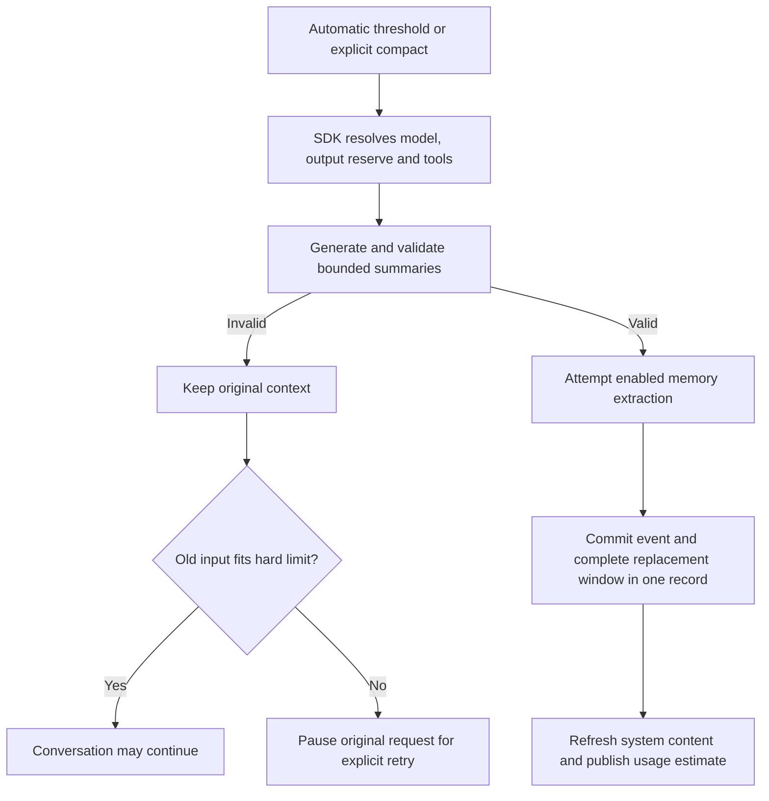

# Model metadata and context management

This page describes the SDK implementation used by WebUI. Interface adapters select models, display events and request operations; they do not maintain a separate context or memory store. See [WebUI usage](../../../webui/README.md#model-capabilities-and-context) for controls and installation behavior.

## Catalog ownership and updates

| Layer | Responsibility |
| --- | --- |
| `ms_agent/llm/model_catalog.py` | Parse and validate models.dev data; resolve provider aliases, model capabilities, prices and provenance locally |
| `ms_agent/llm/catalog_update.py` | Download, validate and publish a compatible cache version; choose between cache and bundle at process startup |
| `.dev_scripts/update_model_catalog.py` | Explicit maintainer refresh of the tracked snapshot and manifest |
| WebUI | Startup policy and Settings controls over the shared SDK service |

The tracked bundle includes the snapshot, SHA256 manifest and upstream license. Package builds validate it; they do not fetch a new catalog unless preparation explicitly requests an update. Runtime downloads never modify source files. A complete cache directory is validated before its current-version pointer is atomically replaced. Invalid or interrupted updates leave the previous version usable.

The process fixes one catalog revision so model selection, budgets and prices agree. Source WebUI startup may refresh its cache; installed packages default to local data. A manual update needs a restart to activate changed data. `auto`, `local` and `bundled` policies, cache timing and the offline launcher option are documented in the WebUI guide. TUI update controls are deferred; the SDK service is shared.

The catalog describes advertised capability, not account access or endpoint behavior. Explicit configuration takes precedence where supported. Native thinking parameters lock the shortcut rather than silently overriding a visible selection. Each session stores reasoning choices by provider and model; an explicit change also updates the new-session default. Restoring a session only reads its saved choices.

Built-in selection is limited to 19 reviewed providers: ModelScope, DashScope China, Alibaba International, Zhipu China, Z.AI, Kimi China, Moonshot International, DeepSeek, MiniMax, LongCat, Xiaomi MiMo, StepFun China/International, SiliconFlow China/International, OpenAI, Anthropic, Google Gemini and OpenRouter. Other services can be configured as custom providers. The complete upstream snapshot remains available for metadata; downloading newer data does not expand this allowlist.

## History, active context and memory

| Data | Purpose | Persistence |
| --- | --- | --- |
| Original conversation | User-visible audit history, tool results and recovery evidence | Append-only session JSONL |
| Active context | The messages actually assembled for the next model call | A committed replacement window in the same JSONL |
| Project memory | Selected durable facts across conversations | Enabled memory backend, usually MEMORY.md |
| Context status | Estimates and operation progress for interfaces | Session metadata and display-only operation records |
| Usage journal | Observed provider usage, independent of conversation success | Per-session `.usage.jsonl` managed by SessionLog |

Compaction does not rewrite original history. System messages, the latest user input and protected tool groups are retained. Older eligible messages become a summary. Current system files and memory are assembled again before the next request; the summary is not a replacement for system instructions.

The single commit record contains the full replacement window and its completion event. Readers expand only complete, validated records and derive the boundary from them. A torn trailing line cannot publish half a window. Legacy records remain readable. This gives the conversation window one recovery boundary; it does not make MEMORY.md and the session log a cross-file transaction.

Summary generation uses bounded fragments and hierarchical merging when necessary. Empty, truncated or error-shaped summaries are rejected; automatic continuation is disabled for summary requests. Retries and total summary calls are bounded. Summaries may omit facts: reliable recovery and correct request assembly do not guarantee lossless summarization.

Memory extraction has a separate purpose: select durable facts, corrections and preferences. Its input budget follows its actual model, with output headroom and chunking. The final memory character limit (normally 2200) is separate from token context limits. All chunks must succeed before replacing the memory file. Outcomes distinguish updated, unchanged, skipped and failed. Ordinary memory failure does not prevent committing a valid summary; original source sequences remain available for retry. Cancellation still aborts the operation. A crash between writing memory and recording its acknowledgement can repeat extraction, so this is not an exactly-once cross-file transaction.

## Operations and accounting

Automatic compaction, SDK `/compact` and the WebUI button call the same SDK operation. Manual work waits for the live agent's input boundary and holds the existing session turn lock. It never inserts a synthetic user message. Navigation leaves it running; explicit Stop cancels the owned operation. The next turn rebuilds from the committed log.

If input remains over the hard limit, the pending request is saved and the failed turn is sealed for normal navigation. A typed `ResumeContext` input resumes it without appending another user message; the log records which error seal no longer belongs in model context. A new user instruction supersedes the pending request. Input that must be retained may require a larger window or a shorter replacement message.

The context meter uses a server snapshot tied to the model, configuration, catalog revision and active window. It estimates system content, tool definitions and messages; a provider-reported residual is shown separately. Output reservation is not consumed input. Memory and skill content stay in their actual category; detailed five-category attribution and exact provider tokenizers are deferred.

Each provider response has a stable usage record identity. Streaming snapshots replace the same response's accumulated usage, while continuations remain separate responses. The independent journal preserves known usage even if compaction, memory persistence or a later conversation step fails. Restored copies do not add another charge. Raw usage classifications, requested/response model and catalog revision are retained.

Prices are USD estimates from the selected catalog. Input includes cached tokens before separating cache read/write charges; reasoning tokens are a subset of output. Context tiers apply to each response, not the sum of a continued answer. Missing usage, prices, incomplete streams or unsupported cache TTL distinctions produce partial/unknown estimates with reasons, not a zero bill. Cost display is deferred.

## Validation boundary

Deterministic tests cover commit faults, restoration, request budgets, chunking, source retry, usage normalization, streaming cancellation and interface contracts. Real WebUI acceptance must separately cover model configuration, multiple providers, tools/images, automatic/manual compression, Stop, reload, restart and pending-request retry. Wheel/sdist and image checks validate the exact prepared candidate; a source test is not proof of an installed artifact. No component promises unlimited context, exact invoices or lossless memory.
