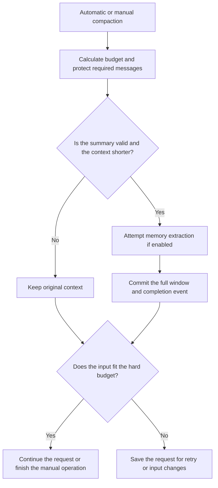

# Model catalog and context compaction

MS-Agent uses the [models.dev](https://models.dev) catalog for model capabilities, context limits and prices. The SDK uses this data to configure requests, calculate input and output budgets, and compact older messages as a conversation approaches its context limit.

This page covers catalog updates, compaction and recovery. For WebUI controls and configuration, see [Models and context](../../../webui/README.md#models-and-context).

## Model catalog

The SDK includes a catalog snapshot, a SHA256 manifest and the upstream MIT license. Queries read local data; model execution does not depend on downloading the catalog.

| Module | Responsibility |
| --- | --- |
| `ms_agent/llm/model_catalog.py` | Validate snapshots, match providers and models, and return capabilities, prices and data provenance |
| `ms_agent/llm/catalog_update.py` | Download catalogs, publish them to the user cache and select a version at startup |
| `.dev_scripts/update_model_catalog.py` | Update the tracked snapshot and manifest in the repository |
| WebUI | Call the SDK update service and display catalog status and model settings |

The SDK registers 19 provider entries: ModelScope, DashScope China, Alibaba International, Zhipu China, Z.AI, Kimi China, Moonshot International, DeepSeek, MiniMax, LongCat, Xiaomi MiMo, StepFun China/International, SiliconFlow China/International, OpenAI, Anthropic, Google Gemini and OpenRouter. Other services can be configured as custom providers. The snapshot retains the full upstream metadata, but only reviewed providers are registered automatically. Downloading a new catalog does not expand that list.

Model access still depends on the account and service endpoint. Explicit configuration can override model capabilities. Native thinking parameters in Advanced JSON take precedence and disable the WebUI shortcut. Sessions store reasoning choices by provider and model. An explicit change also updates the default; restoring a session reads its saved choice.

### Updates and version selection

Runtime updates are stored in `$MS_AGENT_HOME/cache/models.dev/v1`. The SDK validates the complete version directory before atomically replacing the `current` pointer. Failed downloads, invalid data and interrupted updates leave the previous version in use. Source files and installed package files are unchanged.

At startup, the SDK selects the newer compatible version from the bundle and cache, then uses it for the lifetime of the process. Capabilities, budgets and prices therefore come from the same data. A catalog downloaded while the service is running takes effect after a restart.

Source WebUI installations check for updates at startup by default; wheels and images default to local data. The WebUI guide documents check intervals, the `auto` / `local` / `bundled` policies and offline startup. TUI has no update controls yet; it can use the same SDK service.

Package builds validate the snapshot from the selected commit. Maintainers can refresh it with the preparation script's `--update-model-catalog` option; see the [WebUI build guide](../../../.dev_scripts/webui/README.md).

## Session history and compaction

Conversation history, model context and project memory are stored separately:

| Data | Contents | Storage |
| --- | --- | --- |
| Original history | User messages, assistant replies, tool results and operation events | Append-only session JSONL |
| Active context | Messages for the next model call, including summaries and retained originals | A committed context window in the same JSONL |
| Project memory | Facts, corrections and preferences used across sessions | The selected memory backend; usually `MEMORY.md` for the file backend |

Compaction retains system messages, the latest user input and protected tool-call groups. It replaces eligible older messages with a summary while preserving the original history in the log. Before the next main request, the system prompt is rebuilt from the current files and memory.

### Summary generation

Summary inputs are split to fit the budget and merged in further passes when needed. Empty content, truncated output and error objects are treated as failures. Summary requests disable automatic continuation, allow at most two attempts per fragment and default to a maximum of 32 calls in total. Reasoning effort can be configured separately; otherwise, the SDK prefers to turn thinking off or use a lower supported setting.

Summaries lose detail. Store evidence that must remain complete in project files; the original session log is also available for reference.

### Commit and recovery

The full replacement window and completion event are written in one JSONL record. Readers expand only complete, validated records and recover the window boundary from that record. A partial trailing line cannot make part of a window active.

Replay supports both older log formats and the current embedded-window format. Session forks use the same replay rules and inherit the source session's model and reasoning settings.

## Memory extraction

When memory is enabled, compaction can first extract durable facts from the original messages. Extraction uses the actual memory model's context budget, reserves space for instructions, existing memory, tool definitions and output, and splits the input when needed.

File memory defaults to a limit of 2200 characters. This limits the final file and is calculated separately from the model's token window. All chunks must succeed before the memory file is replaced. Results distinguish `updated`, `unchanged`, `skipped` and `failed`.

An ordinary extraction failure retains the previous memory and original source sequence numbers while allowing a valid summary to commit. A later compaction can retry those sources. Cancellation aborts the operation. Memory and session logs are written separately: if the process exits after writing memory but before recording completion, extraction may run again.

## Manual compaction and retry

Automatic compaction, SDK `/compact` and the WebUI button all call `LLMAgent.compact_context()`. Manual compaction waits until the agent is waiting for input and holds the session lock. It does not append a user message or ask the main conversation model to respond. Leaving the page keeps the operation running; Stop cancels it. The next turn rebuilds context from the committed log.

If input still exceeds the hard budget, the SDK saves the pending request and writes an end record for the failed turn so the session can resume normally. `ResumeContext` continues that request without appending another user message. Its log record excludes the corresponding failed-turn end records from model context. A new user instruction supersedes the pending request.

If the latest input or other required content is itself too large, shorten it or use a model with a larger context window.

## Context and cost estimates

### Context usage

The WebUI meter reads a server snapshot of the last assembled request's estimated input. The snapshot is tied to the model, configuration, catalog version and active window. Changes invalidate the estimate until the next request updates it.

Usage is divided into system prompts, tool definitions and messages. Memory and skills count toward the category containing them; any remaining provider-reported difference is shown separately. Output reservation is displayed separately from used input. Estimates currently use a shared method, without provider-specific tokenizers or separate memory and skills categories.

### Per-response usage

`SessionLog` writes observed usage to the session's `.usage.jsonl` file. Cumulative streaming updates share a record ID, and readers use the latest value. Responses produced by automatic continuation are recorded separately. Usage writes are independent of summary and memory commits, so later failures do not discard recorded data. Restored message copies do not add to the totals.

Records retain raw usage fields, requested and response models, and the catalog version. Prices are estimated in USD using that catalog:

- Total input includes cached tokens. Pricing then separates ordinary input, cache reads and cache writes.
- Reasoning tokens are part of output and are not added to the output total again.
- Context price tiers apply to each response. Continuation responses are priced individually.
- Missing usage or prices, incomplete streams and unsupported cache TTL pricing retain known amounts with a `partial` or `unknown` status. Missing values are not treated as zero.

`complete` means the fields required for the catalog estimate are available. Plans, discounts and other provider billing rules still require reconciliation. Amounts are not currently shown in WebUI.

## Validation

Regression tests cover commit failures, log recovery, budgets, chunking, failed-source retry, usage normalization, cancellation and API behavior. End-to-end checks also need to cover real model configuration, tools and images, automatic and manual compaction, Stop, reload, restart and pending-request retry.

Validate wheels, sdists and images from the same candidate source, including resource integrity, installed startup and offline queries. Source tests do not replace installed-package checks.
