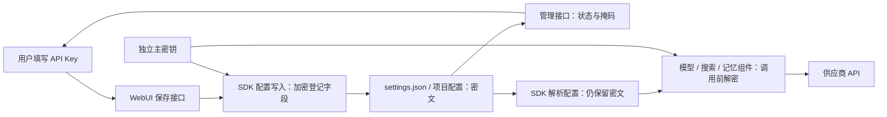

# 凭据加密：设计与部署

[English](secret_storage.md)

## 1. 解决什么问题

API Key 原先以明文保存在 `settings.json`、项目配置和旧历史快照中。复制项目、备份或导出应用目录时，可能把可直接使用的 Key 一并带走。

现在采用 **Fernet 字段加密 + 独立存放的实例主密钥**：配置中的敏感值保存为 `enc:v1:…`，调用模型或工具前才解密。单独获得应用数据或项目文件的人，不能据此还原已加密的 Key。新生成的历史快照进一步清空凭据，恢复会话时使用当前配置。

这层保护针对**文件意外泄露**。主密钥和数据一起被复制、运行进程被控制，或同权限程序读取主密钥时，它不能继续保密；也不替代 WebUI 登录、HTTPS 和容器隔离。

## 2. 核心决策

| 决策 | 原因与影响 |
| --- | --- |
| 使用 `cryptography` 的 Fernet | 采用现成的对称加密与完整性校验，不自制算法；依赖放在 SDK，WebUI、TUI 共用 |
| 每个实例一把主密钥 | 降低实现和运维成本；首次保存非空凭据时生成，不需要用户记密码 |
| 主密钥放在应用目录旁边 | 默认只导出应用目录时，不会连钥匙一起带走；路径可根据 home 确定 |
| 按已登记字段加密 | 保留 JSON/YAML 结构和可读性；未知工具字段需要主动接入 |
| 配置对象保留密文，消费端解密 | 避免读取后修改其他设置时，把解密结果写回文件 |
| 新历史清空凭据，旧历史迁移 | 沿用当前主线的历史最小化策略；既保护旧文件，又减少新副本 |
| 丢失主密钥时明确报错 | 不把密文当 Key 发出，不用自动重建主密钥掩盖旧凭据已无法恢复的问题 |
| 首版不接系统钥匙串、KMS、自动轮换 | 保持本地与 Docker 的一致性；平台可通过外部文件注入主密钥 |

主密钥生成和配置写入使用文件锁及原子替换；迁移不生成额外的明文备份。密文有版本前缀，当前只识别 `enc:v1:`。版本前缀为以后演进留出空间，不代表已经实现自动换钥匙。

## 3. 数据放在哪里

| 内容 | 位置与行为 |
| --- | --- |
| 应用目录 | `MS_AGENT_HOME`，默认 `~/.ms_agent` |
| 默认主密钥 | **规范化后的** home 路径加 `.secrets/master.key`，默认 `~/.ms_agent.secrets/master.key` |
| 全局配置 | `$MS_AGENT_HOME/settings.json`，登记字段加密 |
| 项目配置 | `<项目>/.ms_agent/config.yaml`、可选 `settings.local.json`，登记字段加密 |
| 历史配置 | `<项目>/.ms_agent/memory/*.yaml`：旧字段迁移加密；新快照清空凭据 |
| 历史消息 | 原有 JSON/JSONL 消息保留；不对正文做通用加密 |

兼容旧项目目录 `.ms-agent` 和旧历史目录 `.memory`。这里的项目 YAML 不是项目根目录下用户手写的 `agent.yaml`；任意源配置文件不会被自动改写。

Linux/macOS 默认主密钥目录为 `0700`、文件为 `0600`，拒绝默认密钥文件及其父目录的符号链接。home 本身先解析为真实路径，因此 home 别名指向同一把钥匙。Windows 文件访问权限需另行验证。

平台可选择以下一种外部来源，不能同时设置：

- `MS_AGENT_SECRET_KEY_FILE`：指向预先提供的 Fernet 密钥文件，可只读挂载，推荐用于 Docker。
- `MS_AGENT_SECRET_KEY`：直接注入 Fernet 主密钥值，适合已有秘密管理系统的环境。

明确配置的来源为空、缺失或格式错误时，系统报错，不回退到默认路径；外部主密钥不会复制到应用目录。新增的这两个变量不会传给 WebUI 的 Node SSR、shell 和 LSP 子进程。这只是减少不必要的继承，不是同权限进程之间的安全隔离。

## 4. 一次 WebUI 操作经过哪些层



| 用户操作 | 实际行为 |
| --- | --- |
| 首次填写 Key 并保存 | 初始化主密钥，加密后写入；主密钥无法创建时，保存失败，不落明文 |
| 重新打开编辑框 | 不回填 Key；页面显示未设置、已配置或密钥不可用 |
| 修改名称、地址或模型参数 | 未提交 Key 表示保留已有值，不重新填写也能保存 |
| 替换 Key | 加密新值，复用当前主密钥；这是更换 API Key，不是轮换主密钥 |
| 明确清除 Key | 接口中的空字符串表示清除；`null` / 省略表示保留；清理旧模型块中的重复 Key，避免恢复旧值 |
| 获取模型列表、发送消息 | 只解密所选供应商的凭据；搜索、标题、事实抽取和嵌入模型也接入各自的调用位置 |
| 保存 / 恢复历史 | 新历史移除凭据，已有消息保留；WebUI 恢复使用当前模型、工具与记忆配置 |
| 使用 TUI / SDK | 复用同一存储层；TUI 模型管理、搜索设置与模型列表探测同样接入 |

管理接口不返回明文或密文；输入校验错误不回显提交的 Key。主密钥变化参与 WebUI 运行时缓存校验，已有会话也不能一直依赖过期的解密状态。加密失败不会悄悄转成环境变量凭据；原本没有保存 Key 的配置仍遵循 SDK 原有环境变量解析规则。

## 5. 升级、迁移与故障恢复

**升级已有实例：** WebUI 启动时扫描全局配置和所有已登记项目，包括尚未打开的项目。SDK 配置解析也检查全局配置和当前项目，管理接口读取全局配置时检查后续导入的旧内容。迁移只处理登记字段，保留其他配置和消息；已有密文不会重复加密。

正常升级不要求用户重新填写 API Key，也不要求重建向量库：原 Key 的值不变，只改变存储形式；主对话和上下文压缩共用模型客户端，文件记忆复用该客户端，向量记忆的事实抽取与嵌入分别解密所选供应商的凭据。已有历史恢复后使用当前有效配置。这里的“无感”指不增加用户配置步骤，不代表服务升级无需重启或所有历史版本都已逐一验证。

部署方应保证受管配置可写，默认主密钥目录可创建（或提供有效的外部主密钥），并在后续重建中保留数据和对应主密钥。首次迁移有文件读写开销；上线验收应包含一个已有会话和已有记忆的实例，确认续聊、压缩、记忆写入及检索均可继续使用。

迁移逐文件完成，不是整个实例的一次事务。文件损坏，或同一文件中混有无法解密的旧密文时，保留该文件并报错；其他可处理的文件仍可迁移。WebUI 保留管理入口并记录迁移未完成，不能把这种实例当作“全部已保护”导出。SDK 遇到无法安全解析的配置会明确报错。

**主密钥丢失：** 先恢复原主密钥。历史消息仍可查看，使用不可解密凭据的调用失败；缺失默认钥匙时，修改非敏感元数据或清除密文不需要生成新钥匙。只要管理范围内还有旧密文，系统就不会自动创建另一把默认主密钥。

若确认放弃旧凭据，可以先停服务，再执行：

```bash
python -m ms_agent.config.secrets reset --home /path/to/ms-agent-data --confirm
```

此命令清空全局及所有已登记项目的敏感字段，保留供应商、模型、项目定义和历史消息；未登记项目可增加 `--project /path/to/project`。**已有主密钥不会被替换。** 默认钥匙原本已丢失时，清空后首次保存新 Key 才会新建；外部来源仍需运维修复。没有原主密钥，不能恢复原 API Key。

同一数据目录的 WebUI、TUI、SDK 应一起升级。旧版本不能读取新密文；已有备份、手工复制的文件也不在自动迁移范围内。回滚应使用升级前的数据与相应运行版本，不能让旧版本继续写已迁移目录。

## 6. Docker 与实验场如何配合

默认 Docker home 为 `/data`，主密钥位于 `/data.secrets/master.key`。部署方有两种选择：

**A. 两个独立持久卷，适合最小部署。**

```bash
docker run -d --name ms-agent-ui \
  -p 8000:8000 \
  -e MS_AGENT_HOME=/data \
  -v ms-agent-data:/data \
  -v ms-agent-secrets:/data.secrets \
  YOUR_IMAGE:TAG
```

**B. 持久化应用数据，由平台提供只读主密钥。**

```bash
docker run -d --name ms-agent-ui \
  -p 8000:8000 \
  -e MS_AGENT_HOME=/data \
  -e MS_AGENT_SECRET_KEY_FILE=/run/secrets/ms-agent-master \
  -v ms-agent-data:/data \
  --mount type=bind,src=/secure/ms-agent-master,dst=/run/secrets/ms-agent-master,readonly \
  YOUR_IMAGE:TAG
```

`YOUR_IMAGE:TAG` 指包含本功能的镜像；示例不代表当前发布镜像已经包含。外部文件需预先生成有效 Fernet Key，运行用户需能读取它。生产环境另按 [WebUI 部署说明](../webui/README_ZH.md) 配置登录或鉴权网关、HTTPS、目录权限和单 API worker；本功能不改变这些要求。

与后端 / 实验场团队对齐以下约定即可：

| 操作 | 数据与主密钥的处理 |
| --- | --- |
| 重启、升级、重建容器 | 数据和同一把主密钥都要保留；只挂 `/data` 会在重建后丢钥匙 |
| 私有备份、迁移整套服务 | 保留数据和对应主密钥；分开控制访问，恢复时配对使用 |
| 导出、分享模板 | 清空敏感字段；排除**实际主密钥来源**，不只依赖文件名规则 |
| 只导出 `/data` 或单个项目 | 已加密字段仍受保护；若导出其父目录、整个用户 home 或整个容器，可能把钥匙一起带走 |
| 导入已清理模板 | 接收方填写自己的 Key，使用接收方已有主密钥或首次生成的新钥匙 |
| 导入只有密文的模板 | 无原钥匙不能使用旧 Key；恢复原钥匙，或明确清除旧凭据后重新配置 |

SDK 的 ms-agent Agent Hub 适配器会在导入、上传时清理登记凭据。实验场导出是独立系统，仍需由其维护方接入同样的清理约定。加密降低漏清理后的风险，但不能证明外部导出流程已经安全。

## 7. 覆盖范围与维护入口

已登记：供应商 API Key；LLM 通用、供应商专用和视觉模型 Key；搜索引擎及摘要模型 Key；记忆事实抽取和嵌入模型 Key。`${...}` 引用保留原有解析方式，不主动把环境变量值写入配置。

未全面覆盖：任意源 `agent.yaml`、`.env`、MCP 的任意 env/headers、自定义工具字段、消息正文、日志和既有备份。新历史快照还会做通用敏感内容清理，但不能据此承诺识别所有秘密。

新增工具需要同时接入存储字段和消费端：

```python
from ms_agent.config.secrets import register_secret_field, resolve_secret

register_secret_field('tools.my_tool.access_token')
# 配置保存统一走 write_managed_config。
# 发起请求前，仅解密本次使用的值：
token = resolve_secret(config.tools.my_tool.access_token, config=config)
```

主要代码入口：`ms_agent/config/secrets.py` 管理加密、迁移和重置；配置管理器负责统一写入；`ms_agent/llm/credentials.py` 及具体工具负责消费端解密；`utils/history_secrets.py` 清理新历史；WebUI 的 `bootstrap.py`、`providers.py`、`runtime.py` 分别负责启动迁移、管理状态和会话失效检查。增加新的整文件写入入口时，须避免绕过保护层。

发行包还要遵守独立的文件边界：只发现 `ms_agent` 下的 Python 包，排除临时脚本、运行历史、应用数据目录、主密钥目录和本地 `.env`；构建时清理旧的库输出，防止先前误打包的文件残留。`.gitignore` 本身不能保证 wheel/sdist 安全。此规则防止已知运行产物混入发行包，不替代发布前的凭据扫描。
