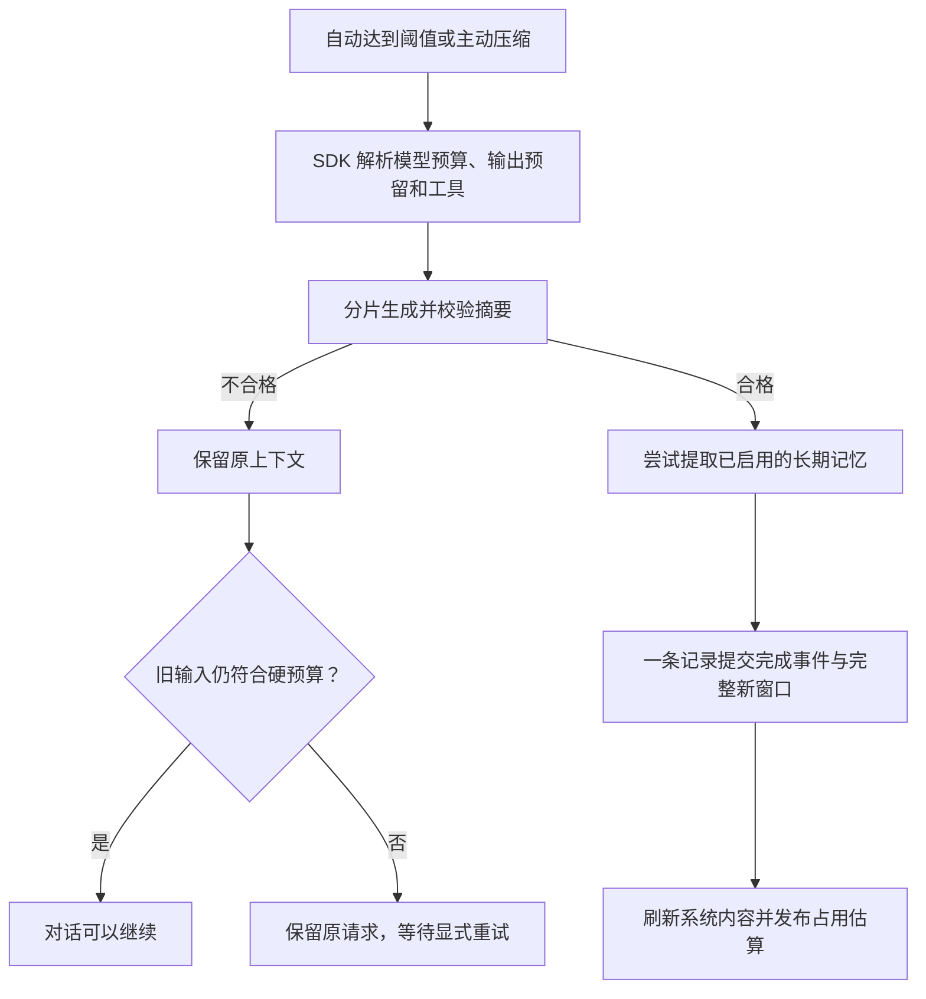

# 模型元数据与上下文管理

本文说明 WebUI 使用的 SDK 实现。界面负责选择模型、展示事件和请求操作，不另建一套上下文或记忆存储。按钮与安装方式见 [WebUI 使用说明](../../../webui/README_ZH.md#模型能力与上下文)。

## 谁负责目录和更新

| 层次 | 职责 |
| --- | --- |
| `ms_agent/llm/model_catalog.py` | 解析、校验 models.dev 数据；在本地解析供应商别名、模型能力、价格和来源 |
| `ms_agent/llm/catalog_update.py` | 下载、校验并发布兼容缓存；进程启动时在缓存和随包数据间选版 |
| `.dev_scripts/update_model_catalog.py` | 维护者显式刷新受 Git 跟踪的快照和清单 |
| WebUI | 通过公共 SDK 服务实现启动策略与设置页操作 |

仓库快照包括数据、SHA256 清单和上游许可证。构建默认校验现有快照，只有准备脚本显式要求时才更新。运行时下载不修改源码：先校验完整缓存目录，再原子替换当前版本指针；坏数据或中断不会覆盖原有效版本。

进程固定使用一个目录 revision，使模型选择、预算和价格口径一致。源码 WebUI 可在启动时检查缓存更新，发行包默认只读本地数据；主动下载的新数据重启后生效。`auto`、`local`、`bundled` 策略、检查间隔与离线启动选项见 WebUI 指南。TUI 更新控件暂缓，公共 SDK 服务可复用。

目录描述模型公开能力，不保证账号权限或具体网关行为。受支持的显式配置可以覆盖默认值。存在原生思考参数时禁用快捷档位，避免界面与请求不一致。会话按供应商、模型保存思考选择；主动修改时也更新新会话默认，恢复旧会话只读取其选择。

内置列表限定为 19 项：ModelScope、百炼中国、百炼国际、智谱中国、Z.AI、Kimi 中国、Moonshot 国际、DeepSeek、MiniMax、LongCat、Xiaomi MiMo、StepFun 中国/国际、SiliconFlow 中国/国际、OpenAI、Anthropic、Google Gemini、OpenRouter。其他服务可通过自定义供应商配置。完整上游快照继续用于元数据查询，下载新数据不会自动扩大此白名单。

## 历史、当前上下文和记忆有什么不同

| 数据 | 用途 | 保存位置 |
| --- | --- | --- |
| 原始对话 | 页面历史、工具结果与恢复依据 | 只追加的会话 JSONL |
| 当前上下文 | 下一次真正发送给模型的消息 | 同一 JSONL 中完整提交的新窗口 |
| 项目记忆 | 跨对话保留的长期事实 | 已启用的记忆后端，通常是 MEMORY.md |
| 上下文状态 | 界面的占用估算与操作进度 | 会话元数据和仅用于展示的操作记录 |
| 用量记录 | 不依赖对话是否成功的供应商回报 | SessionLog 管理的会话 `.usage.jsonl` |

压缩不改写原历史。系统消息、最新用户输入及受保护的工具调用组保留；可压缩的较早消息变为摘要。下一次请求前重新组装当前系统文件和记忆，摘要不替代系统指令。

提交记录包含完整新窗口和完成事件。读取器只展开完整、校验通过的记录，并从中恢复窗口起点；尾部半行不能发布半个窗口。旧日志仍可读取。这为对话窗口提供统一的恢复边界，但不等于 MEMORY.md 和会话日志构成跨文件事务。

摘要按预算分片，必要时逐层合并；空内容、截断或错误对象不能提交，摘要请求禁止自动续写，重试与总调用次数都有上限。正常摘要仍可能遗漏事实：恢复一致、请求组装正确，并不意味着无损压缩。

记忆提取单独筛选长期事实、纠正和偏好。输入预算跟随其实际使用的模型，并预留输出空间、按需分片；最终记忆字符上限（通常 2200）与 token 窗口不是一个概念。所有分片成功后才替换记忆文件，结果区分更新、无变化、跳过、失败。普通记忆失败不阻断合格摘要，原始消息序号保留供重试；用户取消仍中止操作。若写入记忆后、写完成确认前崩溃，提取可能重复执行，不能宣称跨文件“恰好一次”。

## 操作、统计和费用

自动压缩、SDK `/compact` 与 WebUI 按钮调用同一个 SDK 操作。手动压缩等待现有 Agent 的输入边界，并持有原有会话锁，不插入假用户消息。离开页面继续运行，显式停止才取消；下一轮从已提交日志重新构建。

输入仍超硬预算时，保存待处理请求并封口失败轮，使页面可以正常恢复。SDK 的 `ResumeContext` 输入不新增用户消息，而是续接原请求；日志记录哪些错误封口不再进入模型上下文。发送新指令会取代待处理请求。必须保留的输入本身过大时，需要更大窗口或更短的新消息。

圆环使用服务器快照，绑定模型、配置、目录版本和当前窗口。系统内容、工具定义、消息分别估算，供应商回报的未归类差额单列；输出预留不算已消耗输入。记忆和 Skills 留在实际所在类别中，精细五分类和供应商专用 tokenizer 暂缓。

每次供应商响应有稳定的用量记录身份：流式累计更新同一响应，续写则是不同响应。独立用量日志保住已经收到的数据，不因压缩、记忆落盘或后续对话失败而丢失；恢复时的消息副本不重复计费。记录保留原始用量分类、请求与响应模型、目录版本。

价格是目录提供的 USD 估算。输入总量先包含缓存，再拆出缓存读写费用；思考 token 属于输出的一部分。上下文价格档位按逐次响应判断，不拿续写的总输入套一个档位。缺用量、缺价格、流只返回一部分、缓存 TTL 无法准确区分时，明确标为部分或未知并给出原因，不记成免费。费用 UI 暂缓。

## 验收边界

确定性测试覆盖提交故障、恢复、预算、分片、来源重试、用量归一化、流式取消和接口契约。真实 WebUI 还需分别验证配置、多供应商、工具/图片、自动/手动压缩、停止、刷新、重启与待处理请求续接。wheel/sdist 与镜像必须验证同一份实际候选，不能用源码测试替代安装验收。实现不承诺无限上下文、准确供应商账单或无损记忆。
