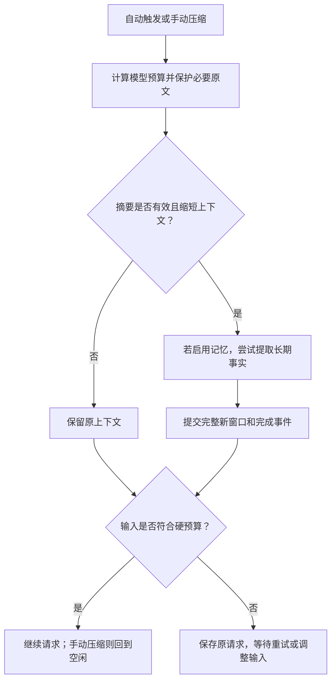

# 模型目录与上下文压缩

MS-Agent 使用 [models.dev](https://models.dev) 的模型目录提供能力、上下文长度和价格信息。SDK 根据这些数据配置模型请求、计算输入输出预算，并在对话接近上下文上限时压缩较早的消息。

本文介绍目录更新、压缩与恢复的实现。WebUI 的操作入口和配置选项见 [模型与上下文](../../../webui/README_ZH.md#模型与上下文)。

## 模型目录

目录随 SDK 一起分发，包含快照、SHA256 校验清单和上游 MIT 许可证。查询在本地完成，模型执行与目录下载相互独立。

| 模块 | 职责 |
| --- | --- |
| `ms_agent/llm/model_catalog.py` | 校验快照，匹配供应商和模型，查询能力、价格及数据来源 |
| `ms_agent/llm/catalog_update.py` | 下载目录、写入用户缓存，并在进程启动时选择版本 |
| `.dev_scripts/update_model_catalog.py` | 更新仓库中受 Git 跟踪的快照和校验清单 |
| WebUI | 调用 SDK 更新服务，显示目录状态和模型设置 |

SDK 预置 19 项供应商：ModelScope、百炼中国、百炼国际、智谱中国、Z.AI、Kimi 中国、Moonshot 国际、DeepSeek、MiniMax、LongCat、Xiaomi MiMo、StepFun 中国/国际、SiliconFlow 中国/国际、OpenAI、Anthropic、Google Gemini 和 OpenRouter。其他服务可配置为自定义供应商。快照保留完整的上游元数据，但只有经过适配的供应商会自动注册；下载新目录不会扩大这份列表。

模型是否可用仍取决于账号权限和服务端点。模型能力可以通过配置覆盖。高级 JSON 中的原生思考参数优先，此时 WebUI 禁用快捷档位选择。会话按供应商和模型保存思考档位；主动修改档位会同时更新默认值，恢复已有会话则只读取会话设置。

### 更新与版本选择

运行时更新写入 `$MS_AGENT_HOME/cache/models.dev/v1`。下载完成后，SDK 校验整个版本目录，再原子替换 `current` 指针；下载失败、数据损坏或操作中断时继续使用原有版本。仓库快照和已安装包中的文件保持不变。

启动时，SDK 从随包快照和兼容缓存中选择较新的数据，并在整个进程内固定使用该版本。这样，模型能力、上下文预算和价格都来自同一份数据。运行中下载的新目录需要重启才能生效。

源码 WebUI 默认在启动时检查更新，wheel 和镜像默认使用本地数据。检查间隔、`auto` / `local` / `bundled` 策略及离线启动选项见 WebUI 使用说明。TUI 尚未提供更新控件，后续可调用同一 SDK 服务。

包构建默认校验选定提交中的快照。维护者可通过准备脚本的 `--update-model-catalog` 选项刷新数据，构建步骤见 [WebUI 打包说明](../../../.dev_scripts/webui/README.md)。

## 会话记录与压缩

会话历史、模型上下文和项目记忆分别保存，供不同场景使用：

| 数据 | 内容 | 保存位置 |
| --- | --- | --- |
| 原始历史 | 用户消息、助手回复、工具结果和操作事件 | 只追加的会话 JSONL |
| 当前上下文 | 下一次发送给模型的消息，包括摘要及保留的原文 | 同一 JSONL 中已提交的上下文窗口 |
| 项目记忆 | 跨会话使用的事实、纠正和偏好 | 所选记忆后端；文件后端通常使用 `MEMORY.md` |

压缩保留系统消息、最新用户输入及受保护的完整工具调用组，将较早的可压缩消息替换为摘要。原始历史继续保存在日志中。下一次主请求前，系统提示会重新读取当前文件和记忆。

### 摘要生成

摘要输入按预算分片，必要时再逐层合并。空内容、截断输出和错误对象均视为失败。摘要请求关闭自动续写，每个片段最多尝试两次，总调用次数默认不超过 32 次。思考强度可以单独设置；未配置时，优先关闭思考或使用模型支持的较低档位。

摘要会损失细节。需要完整保留的证据应写入项目文件，原始会话日志也可用于追溯。

### 提交与恢复

新窗口和完成事件写入同一条 JSONL 记录。读取时，SDK 只展开完整且校验通过的记录，并从记录中恢复窗口起点。写入中断留下的半行不会使部分窗口生效。

回放同时支持旧日志格式和当前的完整窗口格式。会话分叉使用相同的回放规则，继承源会话的模型与思考设置。

## 记忆提取

启用记忆后，压缩前可从原文中提取长期事实。提取使用实际记忆模型的上下文预算，为提示、已有记忆、工具定义和输出预留空间，必要时分片处理。

文件记忆默认限制为 2200 个字符；这是最终文件的长度限制，与模型的 token 窗口分别计算。所有分片成功后才替换记忆文件。提取结果区分 `updated`、`unchanged`、`skipped` 和 `failed`。

普通提取失败时保留旧记忆和原始消息序号，允许合格摘要继续提交；后续压缩可重试这些来源。用户取消则中止整个操作。记忆文件和会话日志分别写入：若进程在写入记忆后、记录完成状态前退出，下次可能重复提取。

## 手动压缩与超限重试

自动压缩、SDK `/compact` 和 WebUI 按钮均调用 `LLMAgent.compact_context()`。手动操作等待 Agent 进入输入等待状态，并持有会话锁；它不追加用户消息，也不触发主对话模型回答。离开页面后操作继续，点击停止才取消。下一轮从已提交的日志重建上下文。

如果输入仍超过硬预算，SDK 保存待处理请求，并为失败轮写入结束记录，使会话可以正常恢复。`ResumeContext` 续接这条请求，不再追加一条用户消息；恢复记录会将对应的失败结束记录排除出模型上下文。用户发送新指令时，旧的待处理请求被取代。

最新输入或其他必须保留的内容本身过大时，需要缩短输入，或改用更大上下文窗口的模型。

## 上下文统计与费用估算

### 上下文占用

WebUI 圆环读取服务器生成的快照，显示最近一次组装请求的输入估算。快照绑定模型、配置、目录版本和上下文窗口；这些条件改变后，旧统计失效，等待下一次请求更新。

统计分为系统提示、工具定义和对话消息三类。记忆与 Skills 内容计入其所在类别，供应商回报中无法归入三类的差额单列。输出预留单独显示，不计入已用输入。目前采用统一估算方法，尚未接入供应商专用 tokenizer 或记忆、Skills 的独立分类。

### 逐响应用量

`SessionLog` 将已收到的用量写入会话 `.usage.jsonl`。同一响应的流式累计值使用相同记录 ID，读取时取最新值；自动续写产生的响应分别记录。用量记录独立于摘要和记忆提交，后续步骤失败不影响已写入的数据，恢复窗口中的消息副本也不会重复累计。

记录保留原始用量字段、请求模型、响应模型和目录版本。价格按该版本目录计算，单位为 USD：

- 输入总量包含缓存 token，计算费用时再区分普通输入、缓存读取和缓存写入。
- 思考 token 是输出的一部分，不重复计入输出总量。
- 上下文价格档位按单次响应判断，续写的多次响应分别定价。
- 缺少用量或价格、流式响应未完成，或无法按缓存 TTL 准确定价时，保存已知分项并标记 `partial` 或 `unknown`，不将缺失值记为零。

`complete` 表示目录估算所需字段齐全。套餐、折扣和其他供应商计费规则仍需另行对账；金额目前不在 WebUI 展示。

## 验证范围

回归测试覆盖提交故障、日志恢复、预算、分片、失败来源重试、用量归一化、取消和接口行为。端到端验证还需检查真实模型配置、工具与图片、自动和手动压缩、停止、刷新、重启及待处理请求续接。

wheel、sdist 和镜像应基于同一份候选源码分别验证，重点检查资源完整性、安装后启动和离线查询。源码测试结果不能代替安装包验证。
